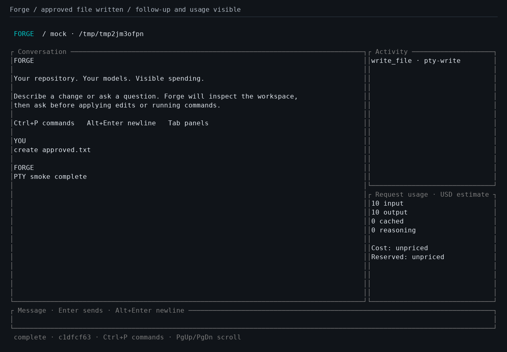

# Forge

[](https://github.com/N-Aymane/forge-harness/actions/workflows/ci.yml)

A Rust coding agent with a full-screen terminal interface, explicit edit/command approvals, and a local spending ledger. Bring your own API keys for OpenAI Responses, Anthropic Messages, or an OpenAI-compatible Chat Completions endpoint.

**Start here:** [Detailed setup guide](docs/SETUP.md) · [Test screenshots and evidence](docs/SCREENSHOTS.md) · [Validation report](VALIDATION.md)



*Actual terminal-test capture with a deterministic local mock provider; no paid model API call.*

## What is implemented

- Keyboard-driven TUI and scriptable CLI with versioned JSONL events.
- Streaming provider adapters, repository reading/search, reviewed file writes, and approved shell commands.
- OS credential-store integration, resumable local sessions, and an SQLite usage ledger.
- Integer cost estimates, transactional session/project/daily budgets, uncertain-charge reconciliation, and approved context summarization.

The initial Linux validation passed 31 Rust tests, the real-terminal approval/resize/cleanup smoke test, Clippy on Rust 1.88 and stable, and Linux/Windows release builds. See [current CI runs](https://github.com/N-Aymane/forge-harness/actions) for native platform results. Real paid-provider tests are opt-in.

## Build and configure

Install stable Rust (1.88 or later) and the native build tools for your platform. Linux builds also require `pkg-config` and the D-Bus development headers (`libdbus-1-dev` on Ubuntu) for Secret Service credentials. Windows normally uses the MSVC Rust toolchain and Visual Studio C++ build tools; GNU Rust with MinGW also works.

```sh
cargo build --locked --release
# Install the binary into your Cargo bin directory:
cargo install --path . --locked
forge doctor
```

In this workspace, an isolated Windows toolchain lives under `.tools/`; use `./scripts/dev.ps1 build --release` if Rust is not on PATH. This directory is ignored and is not part of the product.

Copy `config.example.toml` to the configuration path printed by `forge doctor`. Replace the example model IDs and limits with values supported by your provider. Select `default_model`, or pass `--model ALIAS`. There are no built-in model or pricing assumptions and no automatic provider fallback.

For credentials, either set the model's `key_env` variable or remove that field and run:

```sh
forge auth add primary
# Hidden prompt writes directly to the OS credential store.
forge auth remove primary
```

Windows uses Credential Manager; macOS uses Keychain; Linux uses the desktop Secret Service. A headless system without that service should use environment variables. Do not put keys in TOML. Keys are not command-line arguments. Each alias has its own credential entry.

`--home PATH` overrides both config and data locations for a portable installation. `-C PATH` selects a workspace. An optional `.forge.toml` accepts only `instructions`; project files cannot select credentials, endpoints, shells, or permission settings.

## Terminal interface

```sh
forge -C /path/to/repository
forge --model claude
```

The main conversation and multiline composer sit beside collapsible activity and request-usage panels. Narrow terminals collapse the side panels automatically.

| Key | Action |
| --- | --- |
| Enter | Send a message when idle |
| Alt+Enter / Shift+Enter | New line (terminal support varies) |
| Paste | Paste multiline input |
| Backspace / Ctrl+U | Delete last character / clear composer |
| Ctrl+P | Command palette |
| Tab | Toggle activity and usage panels |
| Page Up / Page Down | Scroll conversation |
| y / n | Approve / deny the current action |
| Up / Down | Scroll the approval preview |
| Esc | Deny approval, close palette, or cancel current turn |
| Ctrl+C | Cancel while running; exit while idle |

Approval dialogs show a unified diff or the exact shell, command, directory, and timeout. File contents are checked again before a proposed write is applied. Denial returns an explicit result to the model. A turn stops after at most 25 model requests.

## Scriptable commands

```sh
forge run "Explain this repository"
forge run "Suggest a fix" --json
forge run - --json < prompt.txt
forge sessions list
forge sessions resume SESSION_ID
forge run "Continue reviewing" --session SESSION_ID --json
forge models
forge usage
forge usage --session SESSION_ID --json
forge usage --project /path/to/repository
forge usage --day 2026-11-03
forge usage --resolve REQUEST_ID --cost 0.0025
```

JSONL output has a `version: 1`, `session`, and `type` in every envelope. Types include `started`, `text`, `activity`, `approval_required`, `usage`, `compacted`, `error`, and `finished`. Monetary fields use integer nano-USD. `null` means unknown/unpriced, not zero.

JSON and noninteractive runs never approve actions. They emit `approval_required`, stop, and exit with code **2**. Errors exit with **1**, successful turns with **0**. An interactive plain-text run can ask for `y` on stdin. Resuming a session retains its model alias and original workspace. Stored tool calls with missing outcomes receive an interruption result; they are never automatically replayed.

## Token usage and budgets

Reported input/output/cache/reasoning counts are stored separately from conservative local input estimates. Estimates use serialized UTF-8 size plus protocol headroom; they are intentionally conservative and are not tokenizer-exact. Reasoning counts are a subset of reported output and are not charged twice. Anthropic cumulative streaming usage is replaced rather than added per event.

Configure current prices in nano-USD per token. **$1 per million tokens = 1,000 nano-USD per token.** For example, a provider charging $2 per million input tokens would use `input_nusd_per_token = 2000`. Cached input and Anthropic cache writes have separate rates. No prices are bundled because prices change. Cost calculations snapshot your configured rates for each request and use checked integer arithmetic. They are estimates, not invoices.

```sh
forge budget set daily 5.00
forge budget set project 2.50 --target /path/to/repository
forge budget set session 1.00 --target SESSION_ID
forge budget list
forge budget remove daily
```

Budgets are optional and combined: every applicable session, project, and global daily limit must allow a request. Daily periods use **UTC**. Reservations include estimated input and the configured maximum output cost; reserving worst-case output can pause a request even if its eventual output would be short. Warnings appear at 80%.

SQLite immediate transactions prevent two Forge processes from spending the same remaining reservation balance. Completed requests reconcile against provider-reported usage. Interrupted, failed, or usage-less requests retain their reservation as `uncertain`; a process crash can leave a `pending` reservation, which also continues to count. There are no automatic retries. Inspect `forge usage --json` and your provider's billing before retrying. Unknown cache-write pricing retains the reservation instead of claiming a complete cost.

An active monetary budget blocks unpriced models. Free local models must have explicit zero rates. Budgets are **local guards, not guaranteed provider billing caps**: provider tokenization, prices, billing details, external API clients, or process interruption can differ from local accounting. A completed response can cost more than its reservation; its full reported cost is retained and subsequent requests are blocked as needed.

At 80% of configured input capacity, Forge asks before making a paid summarization request. It preserves system instructions, the latest user turn and tool exchanges, and full historical records in SQLite. Oversized requests are blocked when compaction is declined or cannot fit. Compaction itself uses the same spending controls.

To resolve an uncertain charge, first verify it with your provider, then run `forge usage --resolve REQUEST_ID --cost USD`. Use zero only for a confirmed unbilled request. This explicit reconciliation is recorded in local history and never runs automatically. Active sessions cannot be reconciled concurrently.

## Local data and execution boundaries

The user configuration and SQLite database locations are shown by `forge doctor`. Sessions, prompts, model answers, approved previews, and tool results are stored locally in plaintext. Protect this directory as you would your source code. API credentials are kept separately in the OS store or environment; the active key is redacted from provider text and tool results, including fragmented streaming text. HTTP error bodies are omitted.

Repository tools reject absolute/traversing paths, symlink escapes, credential files, and internal state directories. Listings/search respect ignore rules. Reads and proposed writes are limited to 256 KiB; shell output is bounded and commands time out after 120 seconds by default (maximum 600). Files must be UTF-8 and new files need an existing parent directory.

Approved shell commands run with your operating-system permissions: **approval is not a sandbox**. They can affect files or network resources outside the workspace. Common API-key/token environment variables are removed from child environments. Cancellation kills the immediate shell; descendants may survive, so inspect the workspace before retrying an interrupted command. There is no undo for arbitrary shell effects. Concurrent hostile filesystem mutations are outside this local-user trust model.

## Development and validation

```sh
cargo fmt --check
cargo clippy --locked --all-targets -- -D warnings
cargo test --locked --all-targets
# POSIX terminal smoke test (uses a local mock provider):
python3 tests/tui_smoke.py target/debug/forge
```

Tests use deterministic mock providers and local fixtures. They cover approval/denial, uninterrupted and interrupted agent turns, missing usage, no tool replay, transactional reservations, fragmented SSE/tool calls, cumulative usage, redaction, stale patches, path restrictions, and narrow terminal rendering. CI runs on Windows, Linux, and macOS, checks the minimum Rust version, and uploads packaged release builds. Paid provider tests are opt-in only; see `tests/live.rs`.

MCP, plugins, subagents, subscription-account authentication, cloud sync, and automatic model routing are outside v0.1. The repository is public; no package has been published to crates.io.
