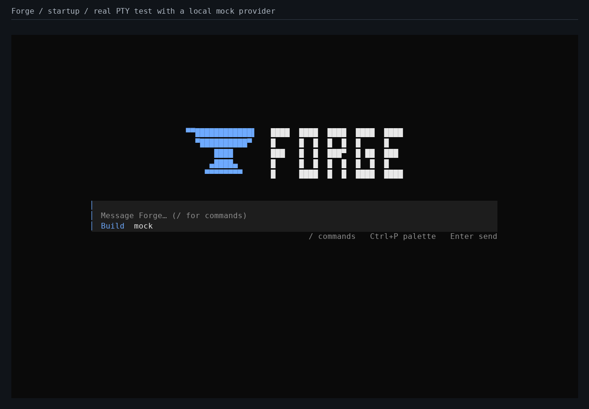
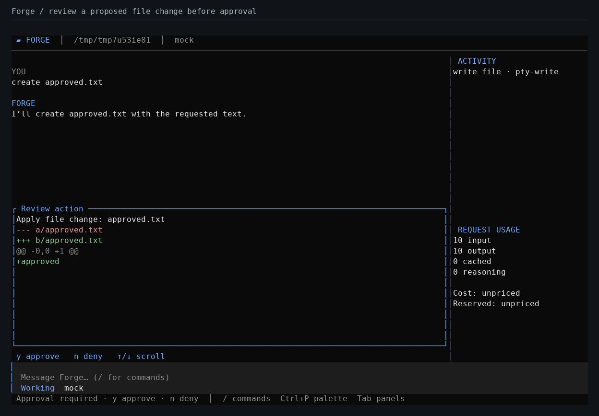
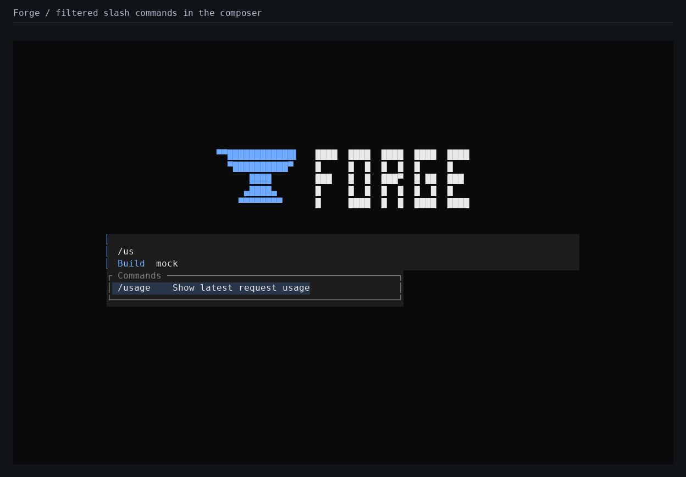

# Forge

[](https://github.com/N-Aymane/forge-harness/actions/workflows/ci.yml)

A Rust coding agent with a full-screen terminal interface, explicit edit/command approvals, and a local spending ledger. Bring your own API keys for OpenAI Responses, Anthropic Messages, or an OpenAI-compatible Chat Completions endpoint.

**Start here:** [Detailed setup guide](docs/SETUP.md) · [Test screenshots and evidence](docs/SCREENSHOTS.md) · [Validation report](VALIDATION.md)

Forge opens to a centered pixel anvil, a block-letter wordmark, and one multiline composer. The working layout appears when you send your first prompt or resume a session with history.



## What is implemented

**New in v0.2.0-preview.1.** Type `/update` to fast-forward a clean Forge source checkout from GitHub `main`. Use `--refine` for an optional Rust planning pass inspired by Harness2, with per-stage records and Forge's existing spending limits. See the [preview release and platform downloads](https://github.com/N-Aymane/forge-harness/releases/tag/v0.2.0-preview.1).

- Keyboard-driven TUI and scriptable CLI with versioned JSONL events.
- Streaming provider adapters, repository reading/search, reviewed file writes, and approved shell commands.
- OS credential-store integration, resumable local sessions, and an SQLite usage ledger.
- Integer cost estimates, transactional session/project/daily budgets, uncertain-charge reconciliation, and approved context summarization.

Validation passed 31 active Linux Rust tests, the real-terminal approval/resize/cleanup smoke test, and Clippy on Rust 1.88 and stable. Native Windows, Linux, and macOS CI passed their test suites, Clippy, and optimized release builds. See [CI results and binary artifacts](https://github.com/N-Aymane/forge-harness/actions/runs/41736340060). Real paid-provider tests are opt-in.

## Install Forge

### Download a release

Download and extract the archive for your platform from the [v0.2.0-preview.1 release](https://github.com/N-Aymane/forge-harness/releases/tag/v0.2.0-preview.1). The release has Windows x64, Linux x64, and Apple Silicon macOS builds. Compare your archive’s SHA-256 with `SHA256SUMS` from the same release. It also ships `config.example.toml`. This release predates the workbench shown in the screenshots above. Build the review branch below to try that interface.

| Platform | Verify the extracted executable |
| --- | --- |
| Windows PowerShell | `.\forge.exe --version` |
| Linux or macOS | `./forge --version` |

Add the folder containing the executable to your `PATH` to use the `forge` commands below from any repository. Alternatively, substitute the full executable path.

### Build from source

You need Git and Rust 1.88 or later. On Windows, install Visual Studio Build Tools with **Desktop development with C++**. On Ubuntu or Debian, install `build-essential`, `pkg-config`, and `libdbus-1-dev`. On macOS, install the command-line tools with `xcode-select --install`. See the [platform setup guide](docs/SETUP.md) for details.

```sh
git clone --branch design/forge-workbench https://github.com/N-Aymane/forge-harness.git
cd forge-harness
cargo install --path . --locked
forge --version
```

Cargo installs the binary in its bin directory, normally `~/.cargo/bin`. If `forge` is missing or still points to an older binary, check your `PATH` and reopen the terminal. Use `cargo install --path . --locked --force` when replacing an existing source install with a build that has the same version.

## Configure a model

1. Run `forge doctor` and find the path labeled `config`. Create its parent directory if needed and copy `config.example.toml` to that exact path. Keep this file outside your project.
2. Choose a model alias such as `primary` (OpenAI Responses), `claude` (Anthropic Messages), or `local` (OpenAI-compatible Chat Completions). Set `default_model` to that alias and fill in the actual model ID, base URL, and token limits. For compatible servers, use the API base URL, typically ending in `/v1`. Forge appends `/chat/completions`.
3. Choose how to provide the API key. For the OS credential store, remove `key_env` from that model’s entry and run `forge auth add primary`, replacing `primary` with your alias. The prompt hides the key. For headless use, keep `key_env` and supply that environment variable in the shell launching Forge. Keep API keys out of TOML and Git.
4. Run `forge models` to check the alias and `forge doctor` again to check configuration and credential availability. `ready (not contacted)` means the local checks passed. The first prompt tests provider access and may incur charges.

If you want a local spending guard before your first request, configure verified provider pricing for the alias, then run `forge budget set daily 1.00` for a $1 USD daily limit. An active budget blocks requests from unpriced models. See [Token usage and budgets](#token-usage-and-budgets) for how reservations work.

## Run your first coding session

Run Forge inside the repository you want to work on, or pass its path explicitly.

```sh
forge -C "/path/to/your/repository"
```

On Windows, for example, run `forge -C "C:\work\my-project"`. To select a configured alias for this launch, add `--model ALIAS`.

1. Start with a read-only task such as “Explain how this repository is organized and suggest where to add a regression test.” Press Enter to send it.
2. Ask for a small change. Read the proposed diff, or check the exact command, shell, and working directory if Forge asks to run a command. Press **y** to approve that action or **n** to deny it. Use the arrow keys to scroll the review.
3. Type `/usage` and press Enter to see the latest request usage. Press **Tab** to toggle the activity and usage rail in a wide terminal.
4. Exit with `/quit` while idle. To return later, use `forge sessions list` and then `forge sessions resume SESSION_ID`. To run one prompt from a script, use `forge -C "/path/to/your/repository" run "Explain the test setup" --json`. JSON mode stops with exit code **2** if Forge needs approval.

Use `--home PATH` on every command if you want a separate configuration and session database. Use a workspace `.forge.toml` with an `instructions` field for repository-specific guidance.

## Terminal interface

```sh
forge -C /path/to/repository
forge --model claude
```

The working view keeps the conversation above the composer and shows recent tool activity and request usage in a collapsible side rail. Narrow terminals hide the rail automatically. Proposed edits appear as colored inline diffs with keyboard approval controls below. Shell approvals show the command, shell, and working directory in the same review area.



| Key | Action |
| --- | --- |
| Enter | Send a message when idle |
| Alt+Enter / Shift+Enter | New line (terminal support varies) |
| Paste | Paste multiline input |
| Backspace / Ctrl+U | Delete last character / clear composer |
| Ctrl+P | Command palette |
| / | Filter local commands from the beginning of the composer |
| Tab | Toggle activity and usage panels |
| Page Up / Page Down | Scroll conversation |
| y / n | Approve / deny the current action |
| Up / Down | Scroll the approval preview |
| Esc | Deny approval, close palette, or cancel current turn |
| Ctrl+C | Cancel while running; exit while idle |

Type `/` to open the command list, use the arrow keys to choose a command, and press Enter to run it. The menu includes `/panels`, `/usage`, `/cancel`, `/quit`, and `/update`. Esc closes the menu.



These screenshots come from the terminal smoke test. The Linux CI job captures startup, slash filtering, inline approval, terminal resize, and the completed turn using a local mock provider. Download the `forge-test-screenshots` artifact from the [redesign CI run](https://github.com/N-Aymane/forge-harness/actions/runs/41868088577).

`/update` fetches the public Forge repository's `main` and fast-forwards a clean Forge source checkout. Forge detects builds launched from the checkout's `target` folder. For an installed binary, set `FORGE_SOURCE_DIR` to the absolute path of the Forge clone before launching Forge. After a source update, quit Forge and run `cargo install --path . --locked --force` in that clone, or rebuild using the command you originally used. Then restart Forge with the new binary. Existing binaries need this version of Forge installed once to gain the slash command.

For example, set the source location in PowerShell before launching an installed binary:

```powershell
$env:FORGE_SOURCE_DIR = 'C:\work\forge-harness'
forge
```

Approval dialogs show a unified diff or the exact shell, command, directory, and timeout. File contents are checked again before a proposed write is applied. Denial returns an explicit result to the model. A turn stops after at most 25 model requests.

## Scriptable commands

```sh
forge run "Explain this repository"
forge run "Suggest a fix" --json
forge run - --json < prompt.txt
forge sessions list
forge sessions resume SESSION_ID
forge run "Continue reviewing" --session SESSION_ID --json
forge models
forge usage
forge usage --session SESSION_ID --json
forge usage --project /path/to/repository
forge usage --day 2026-11-03
forge usage --resolve REQUEST_ID --cost 0.0025
```

JSONL output has a `version: 1`, `session`, and `type` in every envelope. Types include `started`, `text`, `activity`, `approval_required`, `usage`, `compacted`, `error`, and `finished`. Monetary fields use integer nano-USD. `null` means unknown/unpriced, not zero.

JSON and noninteractive runs never approve actions. They emit `approval_required`, stop, and exit with code **2**. Errors exit with **1**, successful turns with **0**. An interactive plain-text run can ask for `y` on stdin. Resuming a session retains its model alias and original workspace. Stored tool calls with missing outcomes receive an interruption result; they are never automatically replayed.

## Optional task refinement

Run `forge --refine run "Review the parser"` for a single turn or launch the terminal with `forge --refine`. The flag authorizes up to four extra model requests per turn. Forge makes a baseline plan, proposes a revised approach, probes that approach by producing another plan, and compares the results to compose advice for the normal agent. The stages use the selected model without tools and share the turn's normal request and spending limits. A failed stage stops the turn with any completed stages retained for inspection.

Run `forge sessions refinements SESSION_ID` to read the latest stage outputs as JSON. Forge keeps guidance scoped to the current turn and preserves the original task in session history. The comparison produces two plans. Workspace execution happens once, through Forge's normal agent loop. See the original [Harness2 research workflow](https://github.com/google-research/harness2/tree/6868817518876de8fd170c6a8354daca273b6191).

## Token usage and budgets

Reported input/output/cache/reasoning counts are stored separately from conservative local input estimates. Estimates use serialized UTF-8 size plus protocol headroom; they are intentionally conservative and are not tokenizer-exact. Reasoning counts are a subset of reported output and are not charged twice. Anthropic cumulative streaming usage is replaced rather than added per event.

Configure current prices in nano-USD per token. **$1 per million tokens = 1,000 nano-USD per token.** For example, a provider charging $2 per million input tokens would use `input_nusd_per_token = 2000`. Cached input and Anthropic cache writes have separate rates. No prices are bundled because prices change. Cost calculations snapshot your configured rates for each request and use checked integer arithmetic. They are estimates, not invoices.

```sh
forge budget set daily 5.00
forge budget set project 2.50 --target /path/to/repository
forge budget set session 1.00 --target SESSION_ID
forge budget list
forge budget remove daily
```

Budgets are optional and combined: every applicable session, project, and global daily limit must allow a request. Daily periods use **UTC**. Reservations include estimated input and the configured maximum output cost; reserving worst-case output can pause a request even if its eventual output would be short. Warnings appear at 80%.

SQLite immediate transactions prevent two Forge processes from spending the same remaining reservation balance. Completed requests reconcile against provider-reported usage. Interrupted, failed, or usage-less requests retain their reservation as `uncertain`; a process crash can leave a `pending` reservation, which also continues to count. There are no automatic retries. Inspect `forge usage --json` and your provider's billing before retrying. Unknown cache-write pricing retains the reservation instead of claiming a complete cost.

An active monetary budget blocks unpriced models. Free local models must have explicit zero rates. Budgets are **local guards, not guaranteed provider billing caps**: provider tokenization, prices, billing details, external API clients, or process interruption can differ from local accounting. A completed response can cost more than its reservation; its full reported cost is retained and subsequent requests are blocked as needed.

At 80% of configured input capacity, Forge asks before making a paid summarization request. It preserves system instructions, the latest user turn and tool exchanges, and full historical records in SQLite. Oversized requests are blocked when compaction is declined or cannot fit. Compaction itself uses the same spending controls.

To resolve an uncertain charge, first verify it with your provider, then run `forge usage --resolve REQUEST_ID --cost USD`. Use zero only for a confirmed unbilled request. This explicit reconciliation is recorded in local history and never runs automatically. Active sessions cannot be reconciled concurrently.

## Local data and execution boundaries

The user configuration and SQLite database locations are shown by `forge doctor`. Sessions, prompts, model answers, approved previews, and tool results are stored locally in plaintext. Protect this directory as you would your source code. API credentials are kept separately in the OS store or environment; the active key is redacted from provider text and tool results, including fragmented streaming text. HTTP error bodies are omitted.

Repository tools reject absolute/traversing paths, symlink escapes, credential files, and internal state directories. Listings/search respect ignore rules. Reads and proposed writes are limited to 256 KiB; shell output is bounded and commands time out after 120 seconds by default (maximum 600). Files must be UTF-8 and new files need an existing parent directory.

Approved shell commands run with your operating-system permissions: **approval is not a sandbox**. They can affect files or network resources outside the workspace. Common API-key/token environment variables are removed from child environments. Cancellation kills the immediate shell; descendants may survive, so inspect the workspace before retrying an interrupted command. There is no undo for arbitrary shell effects. Concurrent hostile filesystem mutations are outside this local-user trust model.

## Development and validation

```sh
cargo fmt --check
cargo clippy --locked --all-targets -- -D warnings
cargo test --locked --all-targets
# POSIX terminal smoke test (uses a local mock provider):
python3 tests/tui_smoke.py target/debug/forge
```

Tests use deterministic mock providers and local fixtures. They cover approval/denial, uninterrupted and interrupted agent turns, missing usage, no tool replay, transactional reservations, fragmented SSE/tool calls, cumulative usage, redaction, stale patches, path restrictions, and narrow terminal rendering. CI runs on Windows, Linux, and macOS, checks the minimum Rust version, and uploads packaged release builds. Paid provider tests are opt-in only; see `tests/live.rs`.

MCP, plugins, subagents, subscription-account authentication, cloud sync, and automatic model routing are outside v0.1. The repository is public; no package has been published to crates.io.
