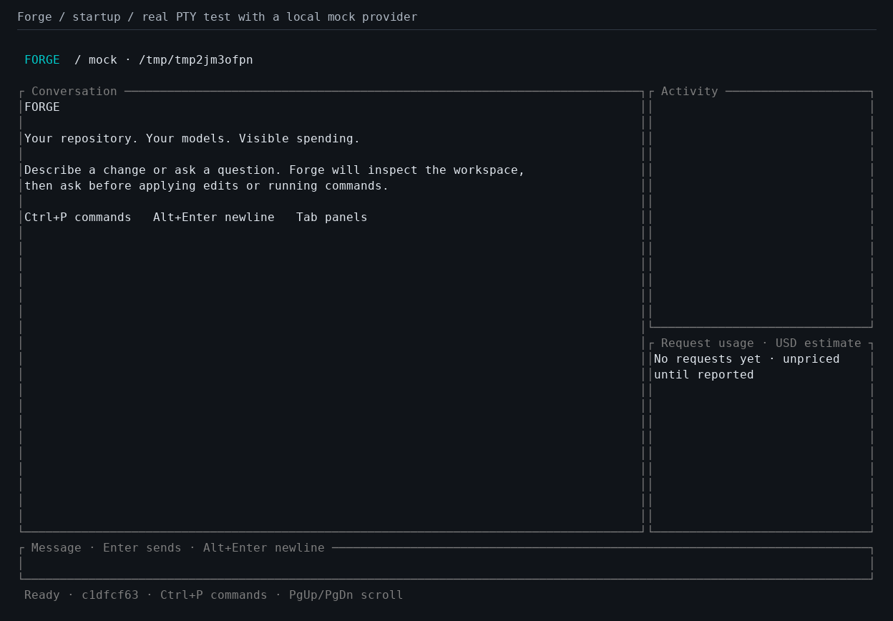
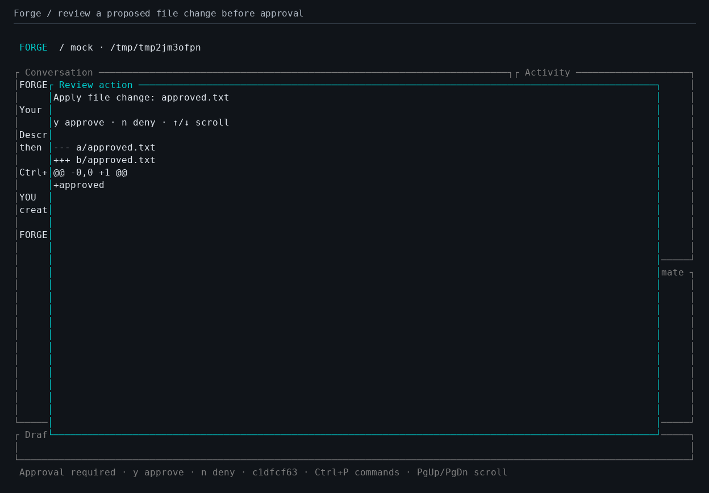
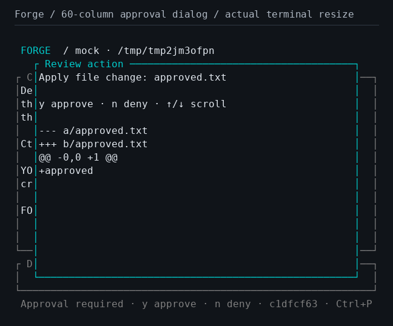
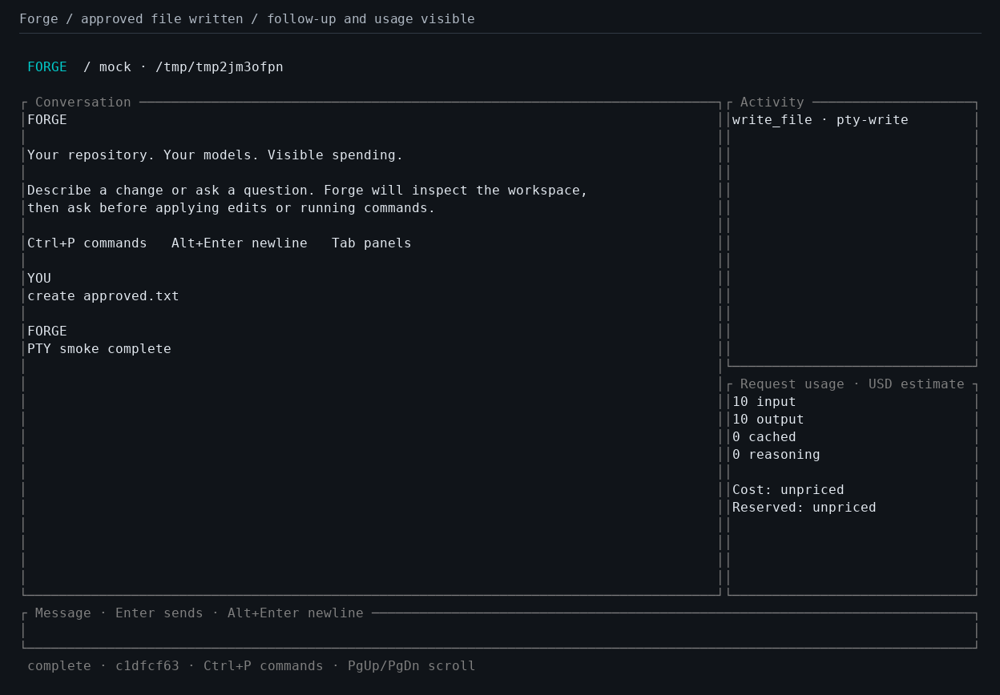
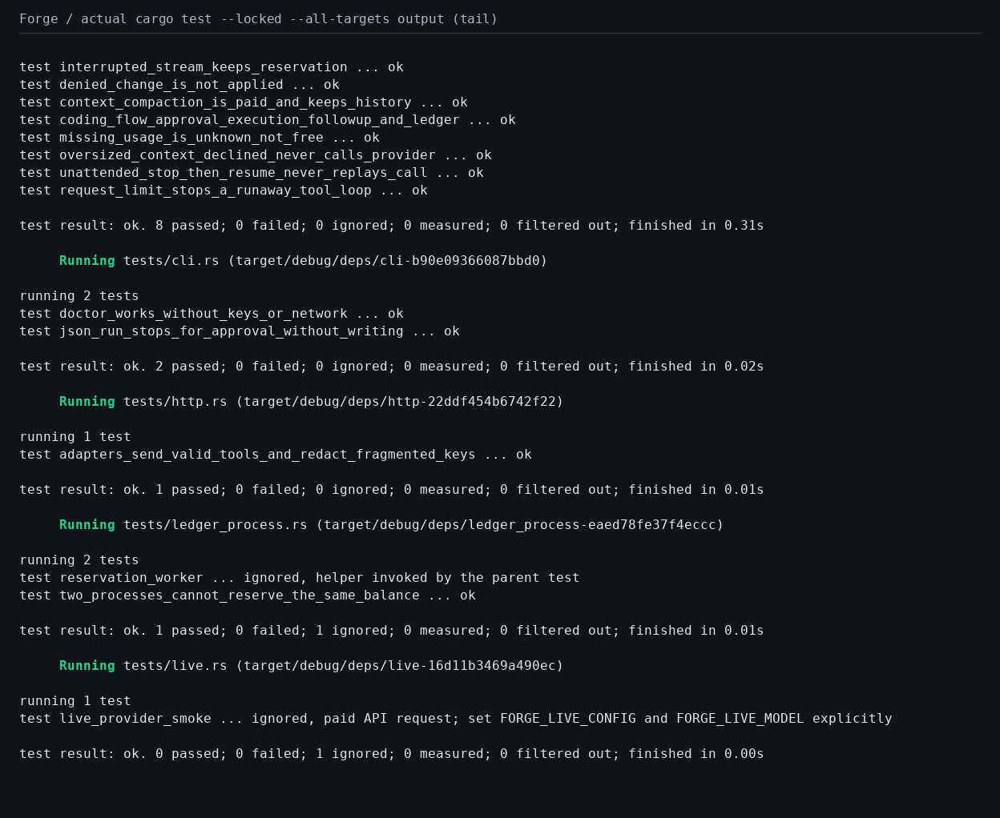

# Test screenshots and evidence

These images are captured from a running Forge executable during its automated POSIX pseudo-terminal test. A local deterministic HTTP provider supplies the tool call and follow-up; no paid model API is contacted. PNGs render the actual terminal bytes using pyte/Pillow and a fixed dark terminal theme. They are test evidence, not UI mockups.

Captured by [CI run 41736340060](https://github.com/N-Aymane/forge-harness/actions/runs/41736340060) from source commit `f71d346a41c3fb780bf09376aa108227ac325c1c`. The PNGs and matching terminal evidence are committed under `docs/images/`. [Machine-readable provenance](images/provenance.json) records the artifact and source revision.

## Startup

The normal 120-column view has a conversation/composer, activity panel, request usage panel, and keyboard hints.

## Approval

The agent proposes `approved.txt`. The test confirms that the file does not exist before approval, then presses `y` in the terminal.

## Narrow terminal

The test resizes the real PTY to 60 columns while the approval dialog is visible. The wide side panels collapse at that width.

## Completed turn

The test checks the new file's contents, the model follow-up saved in SQLite, and restoration of the original terminal settings after Ctrl+C exits.

## Rust tests

The final capture renders the tail of actual `cargo test --locked --all-targets` output. Full test output is included with the images. The initial Linux run passed 31 active Rust tests; an internal subprocess helper and the paid-provider smoke test are ignored at the top level.

[Full test output](images/test-results.txt)

## Reproduce

See [setup guide, verification section](SETUP.md#8-verify-your-installation-and-reproduce-the-screenshots). The renderer writes `.png`, `.ansi`, `.txt`, and `.json` files. Metadata includes each original terminal stream's SHA-256 hash. Capture scripts are in `tests/`; no image-generation service is used.
